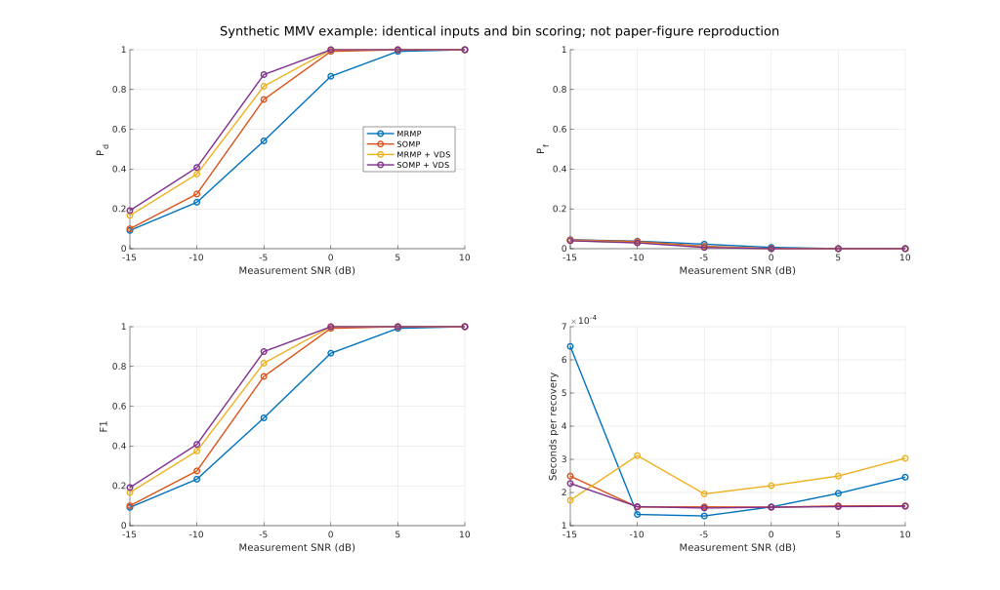

# MRMP: Multivector Reduced-Set Matching Pursuit

Joint sparse recovery from multiple compressed measurement vectors.

[](https://github.com/LhadjBENZATER/Multivector-Redused-set-Matching-Pursuit/actions/workflows/validate.yml)
[Paper](https://doi.org/10.23919/eusipco63237.2025.11226247) · [Download releases](https://github.com/LhadjBENZATER/Multivector-Redused-set-Matching-Pursuit/releases) · [Researcher website](https://lhadjbenzater.github.io/)

The quick start uses the recovered `fct_MRMP.m` reference solver and a complex-safe SOMP baseline on identical synthetic inputs, with and without leave-one-out virtual data synthesis (VDS).

## Run the example

Download and extract the latest release, or clone:

```bash
git clone https://github.com/LhadjBENZATER/Multivector-Redused-set-Matching-Pursuit.git
cd Multivector-Redused-set-Matching-Pursuit
```

Open MATLAB in this directory and run:

```matlab
result = demo_mrmp;
```

The example generates its inputs and needs no private files or SDR hardware.
It writes `results/demo_metrics.csv`, `results/demo_results.mat` and
`docs/preview.svg`. The SVG can be opened in a browser. For numerical output
without plotting, run `result = demo_mrmp(false);`.

The MRMP solver uses `maxk` and `lsqminnorm`; MATLAB R2017b or later is required.
CI runs the numerical checks and plotting example in **MATLAB R2024a on Linux**.
The measured elapsed time and actual runtime version appear in
[the validation log](docs/validation.txt). Runtime depends on hardware and
MATLAB release. GNU Octave compatibility has not been established.



## Model, assumptions and interpretation

`Y = A X + W`, with `A` of size 64 × 128, 4 channels, and 6 active bins.
The dictionary has unit-norm columns. Complex AWGN is scaled from the average
clean compressed-measurement power; SNR is measured after compression. There are
20 paired trials at each of −15, −10, −5, 0, 5 and 10 dB, with seed `20261121`.
Channels have a coherent common signal and independent, equal-variance noise.
VDS is applied **outside the solver**, as `Y*(ones(L)-eye(L))/(L-1)`.
For arbitrary channel phases or different signals, averaging can cancel signal;
the assumed VDS benefit is not universal.

The solver parameters are `bk=0.65` and `a=0.7`. Its original per-column pruning
and support stopping logic are retained. The returned union support can exceed K.
For a consistent bin-level comparison, the demo reports the top K row-energy
scores for **both** algorithms; it does not modify the returned coefficients.
Thus Pd, Pf and F1 in this example reflect a fixed-cardinality reporting policy.
Per-recovery elapsed times are measured with `tic/toc` and depend on the runner;
they are illustrative, not a controlled speed benchmark.

Bin scoring uses TP, FP and FN with **no guard bins or frequency tolerance**:
`Pd = TP/K`, `Pf = FP/(N-K)`, and `F1 = 2TP/(2TP+FP+FN)`.
The detector's support-cardinality policy is described above.

The new example is a reproducible onboarding experiment, **not a reproduction
of the paper's full numerical campaign or hardware measurements**. The legacy
scripts remain available with their original names.

## Files and historical experiments

| Files | Purpose / prerequisites |
|---|---|
| `fct_MRMP.m` | Recovered reference MRMP, used by the new demo; base MATLAB R2017b+ (`lsqminnorm`, `maxk`). |
| `fct_MRMP_Virt.m`, `fct_MRMP_Virt2.m` | Historical virtual-data variants; not substituted for the reference solver. |
| `SOMP.m`, `BOMP.m`, `GOMP.m` | Historical comparison routines; the new demo uses `examples/somp_baseline.m` for complex-safe l2 correlation and duplicate exclusion. |
| `Pd_Pfa_3D_Avgs.m` | Historical simulation; refers to `LFM`, `Phi_selection`, `Virtual` and `diff_chn`, which are absent. |
| `Pd_Pfa_2D_SDR.m` | Historical SDR experiment; needs waveform/measurement helpers and recorded USRP inputs not included here. |

The recovered `fct_MRMP.m` was copied unchanged from the author's earlier
`MRMP_LMF_Starter` source package. **No LMF code or performance claims are added.**
Its logic is not asserted to be a byte-identical implementation of every
pseudocode detail in the EUSIPCO paper. In particular, the historical variants
and the reference solver have different stopping/pruning details.

See [the dependency inventory](docs/LEGACY_DEPENDENCIES.md) before running older
scripts. The new example deliberately avoids those external dependencies.

## Validation

```matlab
addpath tests
run_tests
run_validation
```

`run_validation` runs numerical checks, the demo, and the figure export. GitHub
Actions preserves CSV/MAT outputs as an `example-results` artifact and records
the preview and validation log after a successful main-branch run. The CI badge
reports execution status; it is not a certification of the paper's conclusions.

## Citation

Associated publication: **Multivector Reduced-Set Matching Pursuit (MRMP): A Low-Complexity Approach for Joint Sparse Recovery with Virtual Data Synthesis**, EUSIPCO 2025, pp. 2732–2736, 2025.
DOI: [10.23919/eusipco63237.2025.11226247](https://doi.org/10.23919/eusipco63237.2025.11226247).

Use GitHub's **Cite this repository** control for citation metadata. Cite the
paper when discussing its method, and identify the software release/commit
when reporting results from this code. Paper authorship and software-maintainer
metadata are distinguished in [CITATION.cff](CITATION.cff).

## Questions and contributions

Open an issue with your MATLAB version, command, parameters and full error.
See [CONTRIBUTING.md](CONTRIBUTING.md). Research enquiries:
[Hadj Abdelkader Benzater — EMP](https://lhadjbenzater.github.io/).

## License

Author-contributed code is available under [MIT](LICENSE).
Retain copyright and attribution notices when reusing the code.
